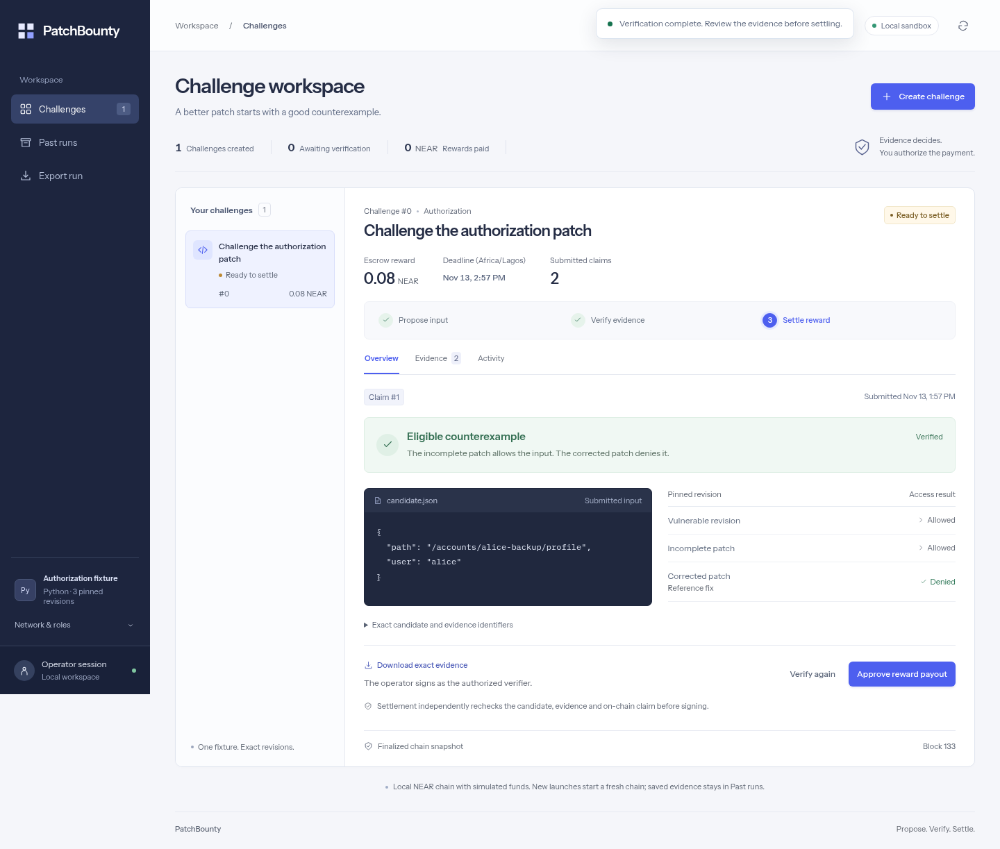

# PatchBounty

PatchBounty is a working non-production application for challenging a synthetic security patch with reproducible counterexamples. A maintainer funds a challenge, independent agents look for a test that breaks the patch, and a verifier checks the result before an escrow releases a reward.

**Status: runnable local/testnet application.** A browser interface, challenge management, deterministic sandboxed verifier, NEAR escrow settlement, candidate generators, evidence downloads, and persistent run journals are implemented. A real testnet payout, replay rejection, failed-transfer retry and expiry refund have been verified. A live NEAR AI Cloud request produced a candidate accepted by the deterministic verifier; inference attestation and response signatures were not verified. See the [run evidence](demo/near-ai-20261107/README.md).

The [testnet demonstration](demo/testnet-20261105/README.md) identifies the deployed contract, transactions and saved evidence. It uses faucet-funded testnet NEAR and a deterministic generator; it is not a production deployment.

For a guided view of those recorded cases, open [the offline walkthrough](demo/index.html) in a browser. Select **Benign input** to see the rejected case, then **Qualifying counterexample** to see why the incomplete patch fails. The settlement panel links to the separately recorded testnet approval and replay rejection. It is a static evidence walkthrough, not a live contract interface.

A [full application recording and draft post](demo/VIDEO.md) demonstrate the runnable flow. The [application testnet run](demo/app-testnet-20261107/README.md) records a fresh payout and expiry refund through the new application.



## Run the complete application

Prerequisites: native Linux with Bubblewrap and the required namespaces, Python 3.10+, Node.js 22.21+ and Rustup.

```sh
scripts/setup.sh
scripts/start.sh
```

Open the printed `http://127.0.0.1:3000` address. Create a challenge, submit the benign sample, verify and reject it; then submit the qualifying sample, verify and approve the reward. The app uses the actual escrow contract on a local NEAR chain with simulated funds. It waits for finalized state and lets you inspect the transfer receipts and exact evidence. On a constrained host with fewer than 65,535 allowed file descriptors, use the explicitly supported `scripts/start.sh --low-fd` demo mode.

See [complete application instructions](docs/APPLICATION.md) for testnet provisioning, optional AI generation, refunds, retries, persistent evidence and browser tests. The interface is a local single-operator tool; all signing keys stay on the server. It accepts only fixed-fixture synthetic candidate data.

## Run the local verifier

Prerequisites: Linux, Python 3.10 or newer, and `bwrap` (Bubblewrap) with unprivileged user and network namespaces enabled. The verifier requires `/usr`, `/lib`, and `/lib64` and executes only the three pinned Python fixtures. It does not accept submitted code. On systems that disallow the required namespaces, it fails closed rather than running on the host.

```sh
python3 verifier.py candidates/qualifying.json
python3 verifier.py candidates/benign.json
python3 verifier.py candidates/rejected.json
python3 verifier.py candidates/invalid.json
python3 -m unittest discover -s tests -v
```

The first candidate returns `eligible`: the vulnerable and incomplete revisions allow Alice to access Alice-backup's profile, while the corrected revision denies it. The next two return `not_eligible`. The invalid candidate returns `error` and exit code 2. A valid but ineligible candidate exits 0; check `decision`, not the exit code, for eligibility. Each successful run emits the candidate, SHA-256 identifiers, per-revision output and exit status, and the decision as JSON. Capture the JSON to retain standalone CLI evidence. The application additionally keeps a persistent run journal and handles explicit escrow settlement.

The runner removes inherited environment variables, disables network access in a namespace, mounts the Python runtime and system libraries read-only, uses a temporary filesystem, and applies CPU, memory, output-file and wall-time bounds. These controls reduce risk for this fixed synthetic fixture; they are not a security guarantee for arbitrary hostile code. See [the challenge specification](docs/CHALLENGE.md) for the predicate and evidence limitations.

To create a standalone review of a successful local run, save the verifier output and render it with `python3 review.py /tmp/patchbounty-verification.json /tmp/patchbounty-review.html`. The output path must be new. This local review has no chain state; the same tool also renders the settlement evidence described in the testnet walkthrough.

The contract's local tests run with `cargo +1.88.0 test --manifest-path contract/Cargo.toml --locked`. The [testnet walkthrough](docs/TESTNET.md) also includes the pinned Wasm build and local NEAR sandbox integration test. The local test uses simulated funds and is not evidence of a testnet payout.

## The first demo

1. A maintainer selects a deliberately vulnerable fixture and an incomplete patch, specifies the challenge rules, and funds a testnet reward.
2. Independent agents propose inputs that expose an explicitly defined security property or behavioral regression.
3. A verifier runs the candidate against exact vulnerable and patched revisions in an isolated environment.
4. A qualifying counterexample is recorded with its evidence, and the authorized verifier submits the result for escrow payout.
5. The same test is run against a corrected patch to demonstrate that it no longer qualifies.

The AI proposes tests; it does not decide whether to pay. The first implementation should use a deterministic verifier for one narrowly defined fixture.

## Why NEAR

- **NEAR testnet:** challenge escrow and payout, with a clearly identified verifier and refund path.
- **NEAR AI Cloud:** private inference for generating candidate tests from sensitive patch material; verify the evidence the service actually supports.
- **NEAR Intents:** optional cross-chain payout experiment after the core workflow works. Do not imply that testnet swaps exist or that simulated transfers are live.

## Build from here

- [Local quickstart](docs/QUICKSTART.md)
- [Product and demo scope](docs/PRODUCT.md)
- [Architecture and trust boundaries](docs/ARCHITECTURE.md)
- [Implementation roadmap and acceptance checks](docs/ROADMAP.md)
- [Handoff for continuing development](HANDOFF.md)

See the [testnet walkthrough](docs/TESTNET.md) for contract builds, account prerequisites, claim verification and settlement. The optional NEAR AI generator requires an API key and may incur charges; it does not verify inference attestation. Do not build a general autonomous hacking platform. Use intentionally vulnerable, synthetic fixtures and only test systems for which you have authorization.

## Hackathon context

PatchBounty was built for NEAR HACKATHON during its development window. The implementation is developed on [`work`](https://github.com/EF-Code/patch-bounty/tree/work) and published on `main`. Review the [change from the initial concept commit to the implementation](https://github.com/EF-Code/patch-bounty/compare/6dad103...main). Plausible tracks include AI Security & Defense and Agent Economy; the team makes the final track selection. Confirm current eligibility and submission requirements in the [official event instructions](https://nearhackathon.com/HACKATHON.md) before submitting. This repository is not itself a hackathon submission.

The project uses Python's standard library and Bubblewrap for the local verifier, the NEAR SDK for the Rust contract, and NEAR Workspaces and Binaryen for local contract integration tests and Wasm preparation. Dependency versions for the contract and integration harness are pinned in their lockfiles. The AI generator calls NEAR AI Cloud; its privacy properties have not been independently verified. The code is available under the [MIT License](LICENSE).

The [submission preparation record](docs/SUBMISSION.md) lists the evidence, latest checks, and remaining owner actions.

## References

- [NEAR documentation](https://docs.near.org/)
- [NEAR AI Cloud private inference](https://docs.near.ai/cloud/private-inference)
- [NEAR AI Cloud verification](https://docs.near.ai/cloud/verification/index)
- [NEAR Intents 1Click request flow](https://docs.near-intents.org/integration/distribution-channels/1click-api/quickstart/making-a-request)

The frontend uses self-hosted Instrument Sans and IBM Plex Mono under their included OFL licenses. The [UI verification record](docs/design/UI-QA.md) covers the redesign, keyboard interactions, responsive layout and automated accessibility checks.
